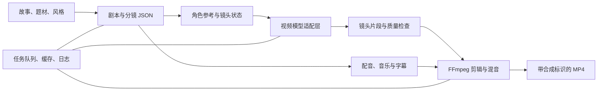

# P30｜“从文本到微电影”AI 创作工作室后续规划

> 中文内部实施规划，编写日期：2026 年 10 月 14 日；阶段计划更新：2026 年 10 月 15 日。依据项目目录第 95–97 页及现有竞标初稿。本文以获得 P30 后由完整七人团队在 2026 年 10 月 21 日至 2027 年 4 月 1 日期间实施为前提，与 P19、P21 互为备选，不代表志愿排名。技术、数量和时间安排均为建议；GPU、训练数据、模型许可、存储和验收口径需在启动时确认。

## 1. 项目目标与最终使用场景

系统让用户输入故事梗概，选择题材、语言和视觉风格后，获得带字幕、合成配音和背景音乐的可下载 MP4 微电影。处理过程应让用户看见阶段进度：故事被转为结构化剧本与分镜，建立角色参考，逐镜生成短视频，完成配音、音乐、字幕和剪辑。生成失败时，用户能知道失败镜头、重试原因及是否使用降级输出。

项目的核心不是一次性调用模型，而是搭建可恢复、可替换、可评估的端到端工作流。建议先以单角色、4–8 个镜头、30–60 秒的完整流程验证；资源和质量条件通过后，以 1–2 分钟成片作为建议交付目标。目录提及 1–10 分钟微电影和五分钟科幻展示，这些是更高资源条件下的扩展，不能在未验证前承诺。

## 2. 正式要求与交付范围

| 范围 | 内容与完成安排 |
| --- | --- |
| 目录要求 | 微调剧本 LLM、文本到视频、角色一致性、配音与音乐、自动剪辑、网页或桌面工具、下载含字幕 MP4；数据预处理、训练模型与权重、评估、部署、文档、维护计划与 AI 内容披露。 |
| 建议首版 | 12 月 15 日前完成受控题材的单角色短片：结构化分镜、模型适配、视频合成、字幕和 MP4 导出。 |
| 完整目标 | 12 月 15 日前完成有限适配试验、角色参考、初步双语音频及工作室骨架；3 月 1–9 日完成题材／风格选择、局部重生成及任务队列集成，3 月 10–16 日评估 1–2 分钟目标、质量与资源，达不到时与导师确认调整。 |
| 可选扩展 | 多角色、更多风格、实时预览及五分钟等更长展示片。只有 GPU、许可和质量验证满足条件才纳入。 |

目录明确要求训练或适配模块、模型权重及评估报告。因此 API 调用不能被写成模型训练成果。首选轻量微调或 LoRA：分别为剧本、视频、角色一致性和音频模块记录基座模型、数据来源、许可、训练配置、版本、评价与可发布性。若某模块只能调用获准服务，应明确它是集成能力，并与导师确认是否满足该模块交付要求。

## 3. 推荐技术路线与系统架构

建议采用 Python、FastAPI、React、Celery/Redis 任务队列，原型数据库首选 SQLite，FFmpeg 负责合成，PyTorch、Hugging Face Transformers/Diffusers 和 OpenCV 支撑模型与视频检查。模型服务通过统一适配层接入。GPU 任务在工作节点运行，网页提交作业、显示阶段和下载成片；并发写入成为瓶颈时再迁移 PostgreSQL。

每份项目保存输入、分镜版本、随机种子（可用时）、模型与权重版本、任务状态、资产位置、耗时和失败原因。视频、音频和中间文件应有生命周期策略，避免 GPU 与存储被旧任务耗尽。服务层把“生成”“校验”“合成”作为独立可重试任务，任务完成后才更新最终状态。

## 4. 关键模块实施思路

**剧本与分镜。** 用受约束的 JSON Schema 表达场景、时长、地点、角色、动作、台词、镜头和情绪。先用验证器检查字段、总时长、角色表和敏感内容，再进入生成。微调或 LoRA 前，用小型基座和提示基线比较；训练样本必须有故事、剧本和分镜的许可。无论模型输出多流畅，都以 Schema 检查、角色冲突检查和人工抽样审核决定是否进入视频阶段。

**视频与角色一致性。** 角色档案包括被授权的参考图、描述、服装及风格提示。镜头调用文本到视频或图生视频模型，必要时用 LoRA、参考图条件、姿态／构图控制或时序模块，但按实际模型能力选择。生成后检查分辨率、时长、帧率、可解码性及明显空帧；以角色嵌入相似度、提示对齐和人工评分共同判断一致性。不能把单一人脸相似分数视为角色一致性证明。

**音频与后期。** 剧本台词先分配角色与语言，再做语音合成；背景音乐只使用许可明确的模型或素材。FFmpeg 按镜头状态编排，加入转场、字幕和响度归一化，检查台词时间轴、字幕格式与音画时长。导出前用播放器或 ffprobe 验证封装、音轨、字幕和总时长，生成内容加可见合成标识；水印方案在需求阶段和导师确认。

**任务恢复与局部重生成。** 用户可重做一个分镜而不是全片。系统冻结已通过的镜头，记录输入与资产依赖；替换一个镜头后只重新渲染该镜头及受影响的合成任务。短暂服务错误使用指数退避重试，模型安全过滤、超时或质量不达标则给出失败状态，不假装生成成功。缓存以输入哈希、模型版本和参数作为键，并提供手动失效操作。

**安全、版权与内容治理。** 训练数据、参考图、音乐、声音和模型均建立许可清单；用户声明有权上传参考素材。默认拒绝仿冒真实人物声音或生成未经授权的真实人物肖像，具体边界按学校与导师要求配置。输入和输出保留必要审计元数据，但不将私人素材写进公开日志。演示片在页面、文件及元数据中标注 AI 生成，提示用户生成结果可能有瑕疵。

## 5. 2026 年 10 月 21 日至 2027 年 4 月 1 日的开发计划

| 日期区间 | 重点工作 | 交付物 | 阶段验收条件 |
| --- | --- | --- | --- |
| 2026-10-21 至 2026-11-03 | 确认用户故事、输出标准、GPU、许可与样例；比较候选模型 | 需求规格、资源矩阵、许可清单、可行性记录 | 选定受控首版场景；每个模块有资源与许可结论。 |
| 2026-11-04 至 2026-11-24 | 数据／素材规范、JSON 分镜、队列骨架、剧本与视频基线 | 分镜 Schema、预处理脚本、端到端最小作业 | 一个小故事可产生可解码的无声片段；失败状态可见。 |
| 2026-11-25 至 2026-12-15 | 角色／音频／合成、首版短片及有限适配试验 | 30–60 秒短片、试验记录、界面骨架 | 单角色 4–8 镜头可播放；镜头可替换；版本可追溯。 |
| 2027-01-06 至 2027-02-28 | 已有片段／许可复核、字幕检查、文档草稿 | 维护记录、三月清单 | 每人每周至多一项异步小任务；不要求新增训练或 GPU 交付。 |
| 2027-03-01 至 2027-03-09 | 工作室、双语、局部重生成与恢复集成 | 集成应用、模型／服务记录 | 可提交任务、查看进度、预览、替换镜头并下载。 |
| 2027-03-10 至 2027-03-16 | 质量对照、获准试用、负载／成本与必要修复 | 评估报告、修复清单 | 输出可播放；评估 1–2 分钟目标并记录商定范围。 |
| 2027-03-17 至 2027-03-30 | 冻结、GPU 部署、文档与演示 | 发布包、模型卡、报告、维护材料 | 新环境可运行；代表性故事全流程通过并保留日志。 |

启动阶段结束前若 GPU、许可或训练数据无法满足要求，团队应和导师对齐可调整的交付范围。先保证受控短片闭环、训练／适配记录及可靠后处理，再增加时长、角色和风格。

以下按表中的七个日期阶段展开，不设固定开发周数；任务量按阶段目标和成员可用时间安排。2026-12-16 至 2027-01-05 用于进度调整与资料整理；2027-01-06 至 2027-02-28 为低负荷阶段，一月至二月的学校假期日期仍以正式通知为准；2027-03-31 至 2027-04-01 用于提交检查。首版流程、接口骨架与先导实验前移至十二月，三月在已有成果上集中集成与评估。

### 课程节点与阶段衔接

以下节点依据用户提供的 **暂定关键日期表** 制定，正式通知变化时同步修订三份方案及六份竞标书。

- **2026-10-21：** 开始设备／资源申请；结合本项目的数据、模型与部署需求记录预算和可用条件。
- **2026-10-28：** 伦理表提交；覆盖本项目的数据使用、知情同意及拟议用户／领域评估，参与者相关工作在取得所需批准后进行。
- **2026-11-05：** 团队项目网站上线，仅展示可公开的项目介绍、职责、进度及示例。
- **2026-12-10：** 中期报告提交；报告截至 12 月 10 日已取得的需求、架构、基线和初步核心模块证据，以及风险与后续安排。12 月 15 日前完成首版可演示流程与先导实验；1 月 6 日开始低负荷阶段。
- **2026-12-16 至 2027-01-05：** 整理资料、收集反馈，并按需要完成前面尚未完成的任务；不安排关键集成、参与者试用或必须完成的训练。
- **2027-01-06 至 2027-02-28：** 按低负荷推进，仅做小型异步维护、已有结果复核和文档；不安排关键交付、必须训练或参与者试用。
- **2027-03-01 至 2027-03-09：** 完成已有模块的集中集成。
- **2027-03-10 至 2027-03-16：** 并行完成正式评估、获准试用及必要修复。
- **2027-03-17：** 冻结功能、模型与规则，进入回归、部署和交付。
- **2027-03-30：** 完成发布版本、最终报告、文档与演示材料。
- **2027-03-31 至 2027-04-01：** 提交检查；于 **4 月 1 日前**提交团队最终报告及软件，核对文件、权限与回执。后续软件演示、团队展示及宣传材料所需素材在本阶段准备，其课程提交节点在本开发计划之外。

### 5.1 需求与资源可行性验证（2026-10-21 至 2026-11-03）

- **确定首版创作场景。** 选择受控题材、单角色和有限镜头，确认故事输入、题材／风格选择、字幕、语言和下载流程；约定分辨率、帧率与首版时长，避免同时承诺长片和复杂多角色。
- **盘点 GPU 与模型条件。** 试运行候选剧本、视频和音频模型，记录显存、下载量、单镜头耗时及调用成本；核查权重获取、使用许可和可部署性，形成各模块的资源矩阵。
- **检查数据与适配方案。** 确认故事、分镜、文本—视频对、角色参考和音频资料的来源与许可；选定可尝试的轻量训练方案，区分自行训练、参数适配和外部服务集成。
- **确定接口与评价方法。** 约定分镜 JSON、角色档案、镜头资产和任务状态；准备覆盖题材与语言的固定测试故事，制定叙事、角色、音画和可播放性检查方法，并列出需导师决定的资源缺口。

**阶段成果：** 需求规格、资源与许可清单、模型试运行记录、接口草案及评估方案。若关键模块无法训练或运行，应在此时与导师确认可调整范围，再进入正式开发。

### 5.2 分镜与最小生成流程（2026-11-04 至 2026-11-24）

- **整理数据和素材规范。** 清理故事与分镜样本，统一角色名称、镜头描述及素材标识；划分训练、验证和测试材料，关联许可记录，建立预处理与标注脚本。
- **实现剧本与分镜基线。** 用选定基座和提示模板生成结构化剧本，校验角色、台词、镜头时长与总时长；不合格输出进入修正或失败流程，不直接交给视频模型。
- **搭建视频适配与任务队列。** 统一模型输入、参数和资产返回方式，保存模型版本及可用随机种子；实现排队、运行、成功与失败状态，先验证单个短镜头的生成和解码。
- **连接最小作业。** 从短故事生成分镜，再按镜头生成少量无声片段并保存；检查任务错误是否可见、结果是否对应正确镜头，同时确定后续角色参考和音频模块的接口。

**阶段成果：** 分镜 Schema、预处理脚本、剧本／视频基线及可追踪的最小作业。此阶段用真实视频生成验证技术可行性，静态图拼接仅用于管线调试并明确标识。

**并行准备：** 本阶段同步搭建基础页面／接口骨架及可复用评估样例，供十二月的首版流程使用。

### 5.3 角色一致性与首版成片（2026-11-25 至 2026-12-15）

- **加入角色参考。** 建立角色外观、服装和风格档案，将获授权参考图或模型支持的条件传入各镜头；先检查少量连续镜头，记录人物漂移及提示不一致。
- **完成音频与字幕。** 从台词生成首版配音，匹配背景音乐与情绪；建立台词、字幕和镜头时间轴，检查语音过长、字幕越界及音乐盖过人声等问题。
- **实现自动合成。** 用 FFmpeg 按分镜顺序拼接镜头，加入转场、字幕、混音和合成标识；检查分辨率、帧率、音轨和总时长，并将失败镜头与合成错误分别记录。
- **12 月 15 日前完成 30–60 秒首版。** 用单角色、4–8 个镜头打通故事到 MP4，支持在开发接口中替换一个镜头并重新合成；保存完整资产与版本，人工检查叙事连贯和可播放性。

**阶段成果：** 带配音、音乐、字幕和合成标识的首版短片，角色参考流程及镜头替换能力。只有短片流程稳定后，才逐步扩大时长、角色或风格范围。

**并行前移任务：** 并行在实测 GPU 能力内开展有范围限制、许可允许的微调／LoRA 先导试验，准备 Web 工作室骨架、固定测试提示词及评估脚本；于 12 月 10 日前依据届时已有证据提交中期报告，12 月 15 日前归档配置、许可允许的权重、输出及失败样例。各模块按七人分工并行推进，先采用已约定的受控样例，不同时扩大数据、企业或影片规模。

### 5.4 低负荷维护与异步准备（2027-01-06 至 2027-02-28）

- **按可用时间安排小任务。** 考虑一月至二月可能涉及寒假，每人每周至多一项小型异步任务；建议控制在约 1–2 小时，可按实际可用时间下调，不设必须全员同步的开发会议。
- **复核已有材料。** 以独立小任务复核已保存的先导片段、字幕时序、许可／素材记录及失败样例；基于已有输出起草模型卡、提示词指南与安装说明，不要求新增训练或依赖 GPU 的交付。
- **整理文档和三月清单。** 通过异步简报维护问题清单，整理观众评价表及三月优先事项；一月至二月不设 Web 工作室交付承诺，3 月 1 日恢复集中集成。
- **不建立关键依赖。** 不安排核心模块交付、跨模块集中联调、必须完成的训练或参与者试用；未完成的小任务可移到三月，不影响首版运行。3 月 1 日恢复集中集成。

**阶段成果：** 已有版本的维护记录、文档草稿及三月优先任务清单；不以新功能数量作为阶段验收指标。

### 5.5 适配结果接入与应用集成（2027-03-01 至 2027-03-09）

本阶段仅完善已准备的模块与接口，按七人分工并行联调；保留首版基线，暂缓非核心扩展，避免三月从零开发。

- **复用先导训练或适配结果。** 复用十二月在许可与实测 GPU 条件内完成的剧本微调或 LoRA 先导结果；核对训练配置、损失、权重和样例，用已有验证结果选择版本，不再启动长周期训练；无法自行训练的模块保留与导师确认的集成说明。
- **完善角色与语言能力。** 比较参考条件、短镜头和模型适配对角色一致性的影响；补齐中文／英文配音与字幕，先验证不同语言的时长和显示，再增加题材及风格选择。
- **建设前后端创作流程。** 提供故事输入、任务进度、分镜查看、片段预览及成片下载；让页面状态对应实际任务，显示失败位置与原因，不以虚构进度代替真实处理阶段。
- **本阶段完善局部重生成。** 支持修改单镜头提示或参考素材，只重跑该镜头及受影响合成；补充取消、重试、缓存失效和资产依赖检查，完成从网页提交到下载的联调。

**阶段成果：** 集成创作应用、训练／适配记录、可获取或可发布的权重说明及局部重生成流程。阶段结束时，用户应能提交故事、查看进度、修改镜头并下载带字幕成片。

### 5.6 质量、稳定性与成本评估（2027-03-10 至 2027-03-16）

使用十二月准备的脚本、开发样例及低负荷期整理的现有材料；正式测试划分在评估开始前锁定。算法／抽取对照、获准用户或业务复核、性能检查分组并行，优先必要修复，不追加新模型。

- **本阶段锁定评价版本。** 固定模型、提示模板、生成参数和测试故事，区分训练中已见与未见题材；确定盲评任务，保存片段及成片供多名评价者使用。
- **本阶段比较基线与改进。** 检查叙事贴合、角色一致、镜头连贯和音画协调，结合提示对齐指标与人工偏好；FID 仅在数据与样本条件适用时使用，记录未改善或出现退化的情况。
- **本阶段测试失败与用户体验。** 覆盖超时、任务取消、队列拥塞、断点恢复和镜头替换；按第 7 节建议规模组织试用，记录从输入到下载的困难、等待感受和错误恢复情况。
- **本阶段优化并验证交付时长。** 根据实测调整并发、缓存、短镜头策略及后处理，统计成功率、平均／p95 耗时、GPU 占用和每条成片成本；评估 1–2 分钟目标是否可行，未达到时与导师确认实际交付范围。

**阶段成果：** 模型质量对照、失败案例、用户试用和资源成本报告，以及维护草案。最终版本依据质量与运行条件选择，成片应可正常播放，并保留清晰的 AI 合成标识。

### 5.7 部署与演示交付（2027-03-17 至 2027-03-30）

- **3 月 17 日冻结功能与模型。** 固定代码、模型和资产处理配置，回归代表性故事、双语字幕、局部重生成与失败恢复；检查所有交付成片的音轨、字幕、可播放性和合成标识。
- **3 月 17–23 日验证部署。** 在目标 GPU 环境按容器化或安装文档启动服务，核对权重获取、存储路径和任务清理；补齐 API、使用说明、提示词指南及模型卡。
- **整理模型与维护材料。** 汇总训练数据及许可、预处理、适配配置、评价结果和权重获取条件；明确模型更新、质量监控、故障回退与旧资产清理方式，逐项核对可发布范围。
- **3 月 24–30 日排练现场演示。** 展示故事、分镜、实际生成进度、局部重做和最终 MP4；实测现场生成耗时，准备并明确标注备用成片，交付系统、报告和维护文档。

**阶段成果：** 可部署应用、许可允许的模型交付材料、测试与评估报告、文档和现场演示。验收包括新环境运行、代表性故事完成全流程、成片可播放及生成版本可追溯。

## 6. 七人分工与协作方式

我们根据已有经历和兴趣安排以下分工，遇到不熟悉的方法时共同学习，并通过进度讨论和导师反馈调整任务。以下为获得该项目后的实施计划，P19、P21、P30 互为备选。

| 成员 | 主要分工 |
| --- | --- |
| Ziqian XIONG | 协调团队、导师沟通和 GPU 安排，结合视觉计算与集成经历指导系统设计、视频模型实验及角色一致性检查。 |
| Yun Xin NG | 结合数据准备和模型评估经历，准备文本、视频与参考图数据集，比较候选模型，并支持训练与评估。 |
| Jinyao LU | 结合剧本撰写和视频剪辑经历，审核分镜、开发音频、字幕与最终合成流程，并组织演示故事和观众反馈。 |
| Oswald Yiwen CHONG | 开发后端任务与素材存储，连接各生成阶段，并支持失败恢复、自动检查和部署。 |
| Ziqian ZHANG | 结合标注和数据准备经历，整理角色参考与镜头标注、检查素材一致性，并记录画面瑕疵和失败案例。 |
| Yue WU | 开发并校验结构化剧本与分镜格式，比较剧本生成方法，并与团队共同记录提示和适配实验。 |
| Xinyun HU | 开发故事输入、风格选择、进度、预览和下载页面，对接任务服务，并检查单镜头重生成与重试交互。 |

Ziqian XIONG 与 Yun Xin NG 共同开展模型实验，Yue WU 与 Jinyao LU 核查剧本、镜头和声音的衔接；不熟悉的生成与剪辑工具通过小规模共同实验学习。

集中开发阶段每周讨论进度并检查集成，组长帮助成员拆解任务和协调困难；2027 年 1 月 6 日至 2 月 28 日每人每周至多一项小型异步任务，按可用时间调整，不安排关键集成、必须完成的训练或参与者试用。

## 7. 测试、评估与验收

- **功能正确性**：测试中文／英文、不同题材、空输入、超长输入、无角色、任务取消、断点恢复、单镜头替换、队列拥塞和模型超时；验证状态准确、结果可下载、MP4 可播放且字幕和音轨存在。
- **模型和叙事质量**：固定一个覆盖已见与未见题材的提示词集。建议至少比较提示基线与一个获准的轻量适配方案；由多名评价者以盲评方式评价叙事贴合、镜头连贯、角色一致、音画协调和总体偏好。评价者人数及提示词数量在 11 月 3 日前结合可用资源确认，不事先承诺效果提升。
- **量化与人工检查**：记录 CLIP 类提示对齐指标；只有在数据、实现与样本规模适用时报告 FID，并说明局限。角色嵌入相似度、人工偏好和失败率共同解释，不能单独代表影片质量。统计任务成功率、平均／p95 耗时、重试率、GPU 占用和每条成片成本。
- **工程与用户体验**：每次发布回归代表性提示词，人工检查闪烁、人物漂移、破损手部、无声、字幕越界及转场问题。建议邀请 5–8 名试用者完成“从梗概到下载”任务，记录理解、等待感受、错误恢复和是否识别 AI 标识。

验收以端到端成功、可播放输出、版本可追溯、评估诚实和合规材料齐全为准。实时演示应显示任务进度与实际耗时，避免将预先生成的成片表述为现场即时结果。

## 8. 资源依赖、主要风险与应对

GPU 显存、排队时间和模型下载量是首要约束。以小模型和短镜头做基准，记录实际显存、时长和成本；资源不足时缩短镜头、串行处理、使用许可允许的轻量模型，且把长片和高分辨率列为延期功能。静态图拼接只能作为管线调试或失败降级，必须标识质量与正式视频不同。

训练数据、参考图片、声音和音乐的许可不足时不进入训练或展示；可转为自有、公开且许可明确的素材，或向导师申请调整。模型服务失效时保留可替换适配器、缓存及任务恢复，不能保证生成质量不受影响。角色漂移以参考条件、短镜头、质量门槛和局部重做降低；若仍不可控，收缩角色和镜头类型。

生成内容可能含不适宜、误导或版权风险。通过输入约束、输出审核、合成标识、使用指引和故障记录降低风险；任何内容政策和人像边界以学校、平台和导师要求为准。公开视频、模型权重和数据集的发布范围在最终阶段逐项确认。

## 9. 最终交付清单与项目亮点

交付需求规格、架构图、素材及预处理规范、训练／适配脚本与许可记录、可发布范围内的权重或获取说明、模型卡、API 与前端、任务队列与后期流水线、测试及评估报告、容器化或部署说明、提示词与维护指南、AI 内容披露和现场演示。敏感素材或不允许分发的模型不纳入公开仓库，但在交付说明中写清获取与复现条件。

演示用一个简短梗概展示结构化分镜、任务进度、局部镜头重生成和最终带字幕 MP4，并展示模型版本、耗时及 AI 标识。项目亮点是把生成模型、媒体工程、恢复机制和责任披露连成可检查、可重复运行的工作流。

依据：[项目目录第 95–97 页](../docs/projects/GRP-Project-Catalogue-2627-202610131035%282%29.pdf)、[P30 竞标初稿](bid_P30.tex)。正式要求以目录为准，本文方案用于小组讨论与后续需求确认。
